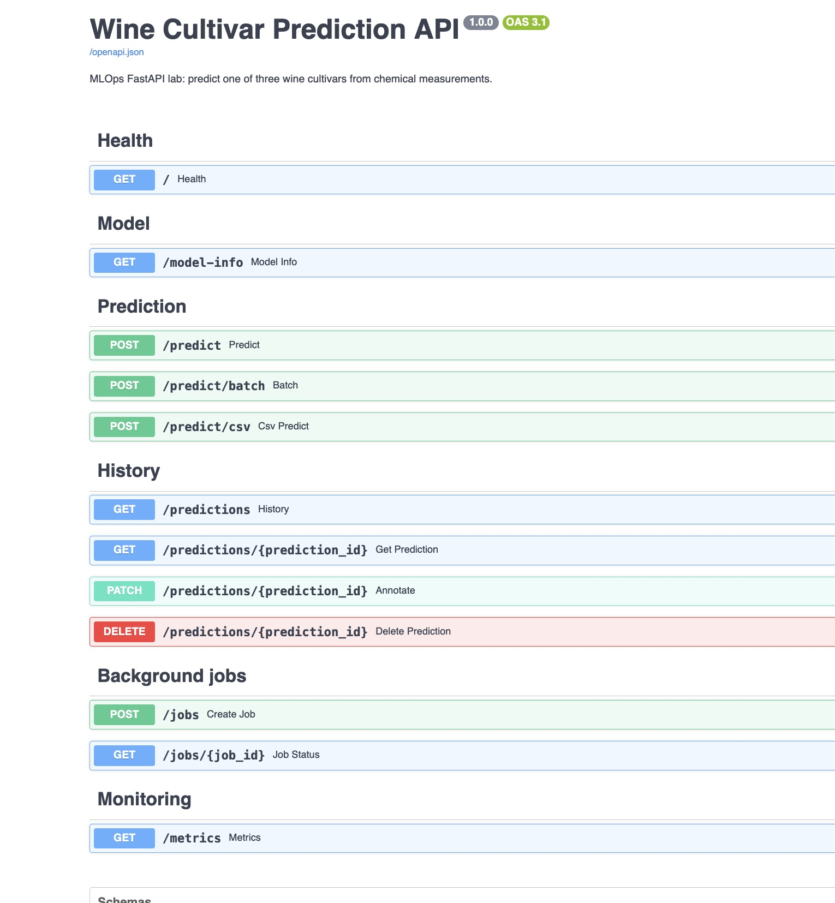

# Wine Cultivar Prediction Service - Machine Learning Operations

An extended version of [Ramin Mohammadi's FastAPI lab](https://github.com/raminmohammadi/MLOps/tree/main/Labs/API_Labs/FastAPI_Labs). The original trains an Iris decision tree. This project serves a wine random forest and explores twelve FastAPI operations, file uploads, dependencies, middleware, persistent CRUD, and background tasks.

**[Overleaf project](https://www.overleaf.com/project/6ae121baf65b08b762ab313e)** · **[PDF report](Machine_Learning_Operations_FastAPI_Report.pdf)** · [LaTeX source](report/main.tex) · [Recorded live HTTP responses](evidence/live-api.json) · [Ubuntu test output](evidence/ubuntu-verification.txt)

## Run with Docker

```bash
docker compose up --build -d
docker compose exec -T api python -m pytest -q
docker compose exec -T api pip check
```

Open **http://localhost:8004/docs**. The image trains the model during its build and loads it once during application startup. SQLite history lives in a Docker volume. `docker compose stop` preserves that history.

Verified inside Docker on Ubuntu 22.04 (aarch64) in UTM. The screenshots use Mac port 8005 forwarded to the VM's loopback port 8004 through SSH; ordinary local runs use port 8004 directly. This is a local, single-worker learning service without authentication.

## Run in a virtual environment

```bash
python3.12 -m venv .venv
source .venv/bin/activate
pip install -r requirements.lock.txt
python -m src.train
uvicorn src.main:app --host 127.0.0.1 --port 8004
```

In another terminal with that environment active:

```bash
python -m pytest -q
python verify_live.py http://localhost:8004
```

`verify_live.py` makes real predictions, annotates and deletes a record it created, and saves evidence. All required inputs, including an example CSV, are in `evidence/`.

## API features

| Method | Route | Purpose |
|---|---|---|
| GET | `/` | Health after successful startup/model load |
| GET | `/model-info` | Model, dataset, split, metrics and feature order |
| POST | `/predict` | Single prediction, probabilities and saved ID |
| POST | `/predict/batch` | JSON batch of 1-100 samples |
| POST | `/predict/csv` | Multipart CSV upload, 1-100 rows, at most 1 MB |
| GET | `/predictions` | History with `cultivar`, `limit`, `offset` filters |
| GET | `/predictions/{prediction_id}` | Saved input, output, timestamp and note |
| PATCH | `/predictions/{prediction_id}` | Update a note (up to 500 characters) |
| DELETE | `/predictions/{prediction_id}` | Delete a saved prediction, returning 204 |
| POST | `/jobs` | Accept a background batch, returning 202 and a status URL |
| GET | `/jobs/{job_id}` | Queued/running/completed/failed status and results |
| GET | `/metrics` | Process request/error counters and stored prediction count |

Pydantic requires 13 finite positive features, rejects unexpected fields, and returns 422 for invalid inputs. Model input order is explicit; JSON key order does not affect predictions. Custom error handlers return request IDs. HTTP middleware adds `X-Request-ID` and `X-Process-Time-Ms` headers. Lifespan startup loads the trusted model artifact; `Depends` injects it into prediction handlers. Blocking prediction/file/database routes run as regular synchronous handlers, while middleware and lifespan use async functions.

### Try the full workflow

1. In Swagger, open `POST /predict`, select **Try it out**, paste `evidence/sample.json`, and execute. Copy `prediction_id`.
2. Retrieve the record, PATCH it with `{"note":"Reviewed in Swagger"}`, and filter history with `cultivar=class_0&limit=2&offset=0`.
3. Send `{"samples":[...two sample objects...]}` to `/predict/batch`, or upload `evidence/sample.csv` to `/predict/csv`.
4. Send the same batch to `/jobs`, then GET the returned `status_url`.
5. Change `alcohol` to `-1`, or remove a required field, and inspect 422 details and the matching request ID.
6. DELETE the saved prediction, then GET it again to observe 404. Check `/metrics`.

Curl examples from the repository root:

```bash
curl -i http://localhost:8004/predict \
  -H 'Content-Type: application/json' --data-binary @evidence/sample.json
curl http://localhost:8004/predict/csv -F 'file=@evidence/sample.csv'
curl 'http://localhost:8004/predictions?cultivar=class_0&limit=2&offset=0'
curl http://localhost:8004/metrics
```

## Verified results

- Wine dataset: 178 observations, 13 features, 3 cultivar labels (`class_0`, `class_1`, `class_2`). These are cultivar classes, not quality scores.
- Stratified split: 133 training / 45 held-out test records, seed 42.
- Random forest: 200 trees, seed 42, fixed settings without test-set tuning.
- Test accuracy: **45/45 = 100%**; macro F1: **1.0000**. Confusion matrix: `[[15,0,0],[0,18,0],[0,0,12]]`.
- All 45 held-out records also classified correctly through the running Ubuntu API. That repeats evaluation through HTTP; it is not a new independent test set.
- **22 tests passed** in the final Ubuntu image. `pip check` found no broken requirements. A Starlette/AnyIO test-client deprecation warning remains; full output is retained.
- Live HTTP checks exercised single/batch/CSV predictions, history filtering/annotations/deletion, 422 and 404 errors, jobs and monitoring.
- A saved record survived a real container restart; see `evidence/restart-persistence.json`.



## Limits

This small dataset and one fixed split do not establish generalization to real laboratory samples. Positive-value checks do not detect all unusual samples, and model probabilities are not calibrated confidence guarantees. BackgroundTasks runs in-process rather than through a durable worker queue. Startup marks unfinished jobs failed; it does not retry them. Run one worker. Batch inputs are validated before inference, but an inference/storage failure can leave earlier rows saved. Request counters reset on restart; SQLite history persists. Do not load untrusted joblib/pickle files.

## Files

- `src/train.py`: deterministic train/test split, model persistence, metrics and examples.
- `src/main.py`: request/response schemas, FastAPI routes, middleware and background jobs.
- `src/store.py`: SQLite prediction/job persistence.
- `tests/test_api.py`: isolated temporary-database contract, lifecycle and failure tests.
- `verify_live.py`: real-server demonstration and HTTP evidence collection.
- `requirements.lock.txt`: complete versions used by the final Ubuntu image.
- `report/`: Overleaf-compatible source and genuine cropped screenshots.

## Attribution

Adapted from Ramin Mohammadi's MLOps FastAPI lab; the upstream CC0 license is retained in `LICENSE`.

Dataset: [scikit-learn Wine recognition dataset](https://scikit-learn.org/stable/datasets/toy_dataset.html#wine-recognition-dataset).
FastAPI references: [request bodies](https://fastapi.tiangolo.com/tutorial/body/), [dependencies](https://fastapi.tiangolo.com/tutorial/dependencies/), [file uploads](https://fastapi.tiangolo.com/tutorial/request-files/), and [background tasks](https://fastapi.tiangolo.com/tutorial/background-tasks/).

Prepared as a Machine Learning Operations lab by Allen Febi Mariaantony Alphonsa, October 27, 2026. Not submitted to the course portal.
